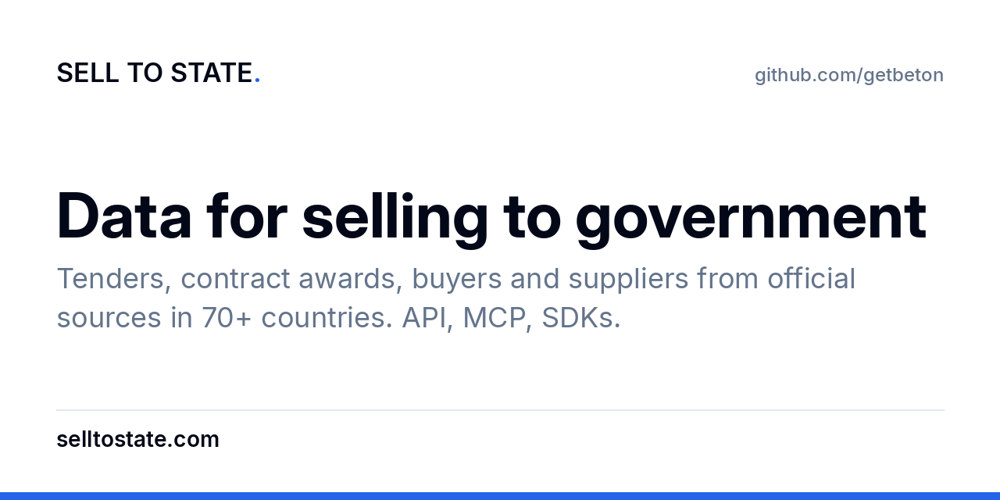

  

We build [Sell to State](https://www.selltostate.com/?utm_source=github&utm_medium=referral&utm_campaign=sts-public-repos&utm_content=org-profile). It collects government tenders and contract awards from official procurement portals in 70+ countries and puts them in one schema: buyer, supplier, amount, dates and sector. Every record links to the official notice.

[Website](https://www.selltostate.com/?utm_source=github&utm_medium=referral&utm_campaign=sts-public-repos&utm_content=org-profile) · [Docs](https://docs.selltostate.com/?utm_source=github&utm_medium=referral&utm_campaign=sts-public-repos&utm_content=org-profile) · [MCP server](https://www.selltostate.com/mcp/?utm_source=github&utm_medium=referral&utm_campaign=sts-public-repos&utm_content=org-profile) · [API](https://www.selltostate.com/api/?utm_source=github&utm_medium=referral&utm_campaign=sts-public-repos&utm_content=org-profile) · [Countries](https://www.selltostate.com/countries/?utm_source=github&utm_medium=referral&utm_campaign=sts-public-repos&utm_content=org-profile) · [X](https://x.com/selltostate)

## Active: Sell to State

| Area | Repo | What |
|---|---|---|
| Agents | [selltostate-skills](https://github.com/getbeton/selltostate-skills) | Agent skills and MCP plugin: Claude Code, Codex, Cursor, Gemini CLI |
| Agents | [selltostate-mcp](https://github.com/getbeton/selltostate-mcp) | Local (stdio) MCP server with an API key |
| API | [selltostate-api-reference](https://github.com/getbeton/selltostate-api-reference) | OpenAPI spec, API guide, llms.txt |
| API | [selltostate-cli](https://github.com/getbeton/selltostate-cli) | Command-line client |
| API | [selltostate-ts](https://github.com/getbeton/selltostate-ts) | TypeScript and JavaScript client (npm `selltostate`) |
| API | [selltostate-py](https://github.com/getbeton/selltostate-py) | Python client |
| API | [selltostate-java](https://github.com/getbeton/selltostate-java) | Java client |
| API | [selltostate-kotlin](https://github.com/getbeton/selltostate-kotlin) | Kotlin client |
| API | [selltostate-rust](https://github.com/getbeton/selltostate-rust) | Rust client |
| API | [selltostate-ror](https://github.com/getbeton/selltostate-ror) | Ruby client |
| Examples | [selltostate-node](https://github.com/getbeton/selltostate-node) | Node.js example |
| Examples | [selltostate-next](https://github.com/getbeton/selltostate-next) | Next.js example (server route) |
| Examples | [selltostate-js](https://github.com/getbeton/selltostate-js) | Browser example (URL shape only) |
| Automation | [n8n-nodes-selltostate](https://github.com/getbeton/n8n-nodes-selltostate) | n8n community nodes and trigger |
| Automation | [zapier-selltostate](https://github.com/getbeton/zapier-selltostate) | Zapier integration |
| Research | [how-governments-buy-ai](https://github.com/getbeton/how-governments-buy-ai) | Notebook: rerun the study "How governments buy AI" |

Remote MCP server: `https://app.selltostate.com/api/mcp` (OAuth). [Attio call agent](https://github.com/getbeton/attio-call-agent) is the CRM agent that the Sell to State team uses after sales calls.

## Active: Vobo

[getbeton/vobo](https://github.com/getbeton/vobo): human review for AI output. Reviewers check model output against policy, and each decision goes on a hash chain. [vobo.dev](https://vobo.dev/?utm_source=github&utm_medium=referral&utm_campaign=org-profile).

## Deprecated: Beton

Beton was open-source revenue intelligence. It is not in active development. The code stays public under its licenses.

| Repo | What | Status |
|---|---|---|
| [inspector](https://github.com/getbeton/inspector) | Buying signals from PostHog data, account scores, CRM routing | Not maintained |
| [dryfit](https://github.com/getbeton/dryfit) | Synthetic analytics data with hidden benchmark truth for agent tests | Not maintained |
| [oss-pricing-data](https://github.com/getbeton/oss-pricing-data) | Open-source pricing dataset: 20 tools, 2023 vs 2026, CC BY 4.0 | Frozen at May 2026 |
| [beton-main-site](https://github.com/getbeton/beton-main-site) | Beton website source, with the pricing teardowns | Site offline |
| [beton-ai](https://github.com/getbeton/beton-ai), [inspector-ml-backend](https://github.com/getbeton/inspector-ml-backend), [openclaw-gtm-skills](https://github.com/getbeton/openclaw-gtm-skills), [seqd](https://github.com/getbeton/seqd), [facade](https://github.com/getbeton/facade), [trolley](https://github.com/getbeton/trolley) | Earlier Beton tools | Archived |

Security problems: use **Report a vulnerability** in the Security tab of the repo. Account questions: support@selltostate.com.
